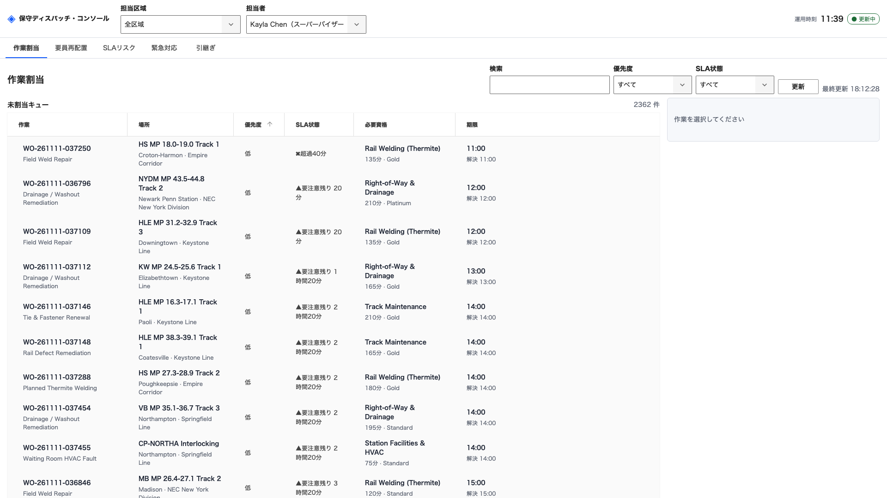

# Dispatcher – Claude Haiku build

**保守ディスパッチ・コンソール** (Maintenance Dispatch Console) is a railway maintenance dispatch console. **Claude Haiku** built it from the Demo 1 [design brief](../../brief.md), starting from an Ignite UI CLI React scaffold. It is one of three builds of the same brief. See the [Demo 1 overview](../../README.md) to compare them.

> **The UI is in Japanese.** All labels come from `src/i18n/ja.ts`, and `index.html` sets `lang="ja"`. Data values such as site names and job numbers stay as the API delivers them, in English. This build followed a variant of the brief that asked for Japanese labels and JST. The current `brief.md` asks for English and EST. The open questions are listed in [`PLAN.md`](PLAN.md#open-questions-see-final-message).

## What it does

It follows direction **A. Operations Ledger** from the brief. Corridor Control and Shift Planner were left out of scope.

| Route | Tab label | Screen | Brief journey |
|---|---|---|---|
| `/`, `/jobs/:jobId` | 作業割当 | **Operations Ledger**: open/unassigned job queue (Grid Lite), filters, and a persistent details panel with ranked crews and a dry-run validation before assigning | 1 Assign a job |
| `/schedule` | 要員再配置 | **Crew reschedule**: technician board (Grid Lite), the selected crew's jobs for the day, and a reschedule panel with impact preview | 2 Reschedule |
| `/sla` | SLAリスク | **SLA risk**: summary tiles, due-by-hour and trend charts (ApexCharts), at-risk grid | 3 SLA risk |
| `/urgent` | 緊急対応 | **Urgent fault intake**: location, impact, priority → create job → route to assignment | 4 Urgent fault |
| `/handover` | 引継ぎ | **Shift handover**: unresolved jobs, incoming owner, handover note (saved as job notes) | 5 Handover |

Behaviour that applies across the app:
- The header on every route shows the region (location context), the acting dispatcher (chosen from `/api/dispatchers`; there is no login), and the operations clock from `/api/meta/clock`.
- Filters and selection live in the URL query string, so they survive opening a job.
- Data is polled every **30 s**. A view is marked **stale** after 90 s without a successful refresh. A failed request shows **disconnected**.
- Conflict detection: before saving, the app re-fetches the job and compares `updatedAt` with the version you loaded.
- Role rules: Dispatcher, SeniorDispatcher and Supervisor. Only senior dispatchers and supervisors can override a blocking validation (`force: true`).

The design decisions are in [`PLAN.md`](PLAN.md). The agent's own 1920 px screenshots of every route are in [`docs/screenshots/`](docs/screenshots):



## Tech

- React 19, TypeScript, Vite 8, React Router 7
- [Ignite UI for React](https://www.infragistics.com/products/ignite-ui-react) `~19.9` (OSS components) and **Grid Lite** (`igniteui-react/grid-lite`, `igniteui-grid-lite` 0.11)
- [ApexCharts](https://apexcharts.com/) via `react-apexcharts` for the SLA charts
- Theme: Ignite UI **Fluent** light (`igniteui-webcomponents/themes/light/fluent.css`), with a palette from the theming MCP server in `src/styles/theme.css` (primary `#155dfc`)
- Generated with Ignite UI CLI 16.0.0 (`ig new dispatcher --framework=react --type=igr-ts`)

## Prerequisites

- **Node.js 22.12 or later** and npm. `package.json` has no `engines` field. This minimum comes from the dependencies: Vite 8 needs `^20.19 || >=22.12`, and `igniteui-webcomponents`/`igniteui-grid-lite` need `>=22`.
- The **Dispatch API** running on `http://localhost:5207`. See the [Backend README](../../Backend/README.md). That includes restoring the database first.

## Run it

```bash
# terminal 1: backend
cd "Demo 1/Backend/DispatchApi"
dotnet run --launch-profile http

# terminal 2: this app
cd "Demo 1/Haiku/dispatcher"
npm install
npm start
```

The app is served at **http://localhost:3101**, and Vite opens the browser automatically (`server.open: true`). `strictPort` is on, so if 3101 is taken Vite stops with an error instead of switching ports.

> The script is `npm start`. There is **no `npm run dev`**. You can also use `npx ig start`, because the Ignite UI CLI is a dev dependency.

## How it connects to the backend

This build calls the API **directly from the browser**. It does not use a proxy.

```ts
// src/api/client.ts
export const API_BASE: string = import.meta.env.VITE_API_BASE ?? 'http://localhost:5207';
// requests are built with new URL('/api/jobs', API_BASE)
```

- Every request path already starts with `/api/…`, so **`VITE_API_BASE` must be the origin only** (scheme + host + port), for example `http://localhost:5300`. Any path you add to it is ignored.
- The request is cross-origin, so the API must allow this app's origin through CORS. The API's `appsettings.json` → `Cors:Origins` includes `http://localhost:3101`, so the defaults work.

**If the API is on a different port**, create `.env.local` in this folder. It is git-ignored.

```bash
VITE_API_BASE=http://localhost:5300
```

Then restart `npm start`.

**If this app runs on a different port** (for example `npm start -- --port 3110`), add that origin to `Cors:Origins` in `Backend/DispatchApi/appsettings.json` and restart the API. Otherwise every request fails with a CORS error.

`VITE_BASENAME` (optional) sets the router base path if you host the app under a sub-path.

## Scripts

| Command | What it does |
|---|---|
| `npm start` | Vite dev server on port 3101 |
| `npm run build` | Type-check (`tsc -b`), then production build to `dist/` |
| `npm run preview` | Serve the built `dist/` on port **3101** (same as dev, so the API's CORS list already allows it) |
| `npm run lint` | ESLint, with zero warnings allowed |
| `npm test` | Vitest in browser mode (Playwright Chromium). **This build has no test files**, so Vitest reports "No test files found". |

`VITE_API_BASE` is applied at build time, so set it before `npm run build` if the deployed app needs a different API URL.

## Project structure

```
Haiku/dispatcher/
├── index.html               # lang="ja", page title
├── styles.css               # app layout styles
├── vite.config.ts           # ports 3101 (dev + preview, strictPort), Vitest browser config
├── PLAN.md                  # route map + implementation plan written by the model
├── docs/screenshots/        # 1920 px captures of each route
└── src/
    ├── main.tsx             # theme imports, router, ConsoleProvider
    ├── app/app-routes.tsx   # lazy-loaded routes
    ├── api/                 # client.ts (fetch wrapper, API_BASE), types.ts
    ├── components/          # AppShell (header/tabs), ImpactDialog, common UI
    ├── context/console.tsx  # region, acting dispatcher, clock
    ├── hooks/useQuery.ts    # polling (30 s) + stale (90 s) handling
    ├── i18n/ja.ts           # all Japanese UI strings
    ├── lib/                 # formatting, Grid Lite cell styles and sizing helpers
    ├── pages/               # OperationsLedger, Schedule, SlaRisk, UrgentFault, Handover
    └── styles/theme.css     # Fluent palette overrides (#155dfc)
```

The other files are AI-assistant configuration used during the build: `AGENTS.md`, `.claude/`, `.agents/skills/`, plus `ignite-ui-cli.json` and the CI templates in `.github/` and `.azure/`. You don't need them to run the app.

## Troubleshooting

| Symptom | Fix |
|---|---|
| 接続が切れています ("disconnected") in the header, or `Failed to fetch` in the console | The API isn't running on `http://localhost:5207`. Start it, or set `VITE_API_BASE`. |
| `blocked by CORS policy` | The page's origin isn't in `Cors:Origins`. Check the address bar: it should be `http://localhost:3101` (not `127.0.0.1` or a custom port). If you need another origin, add it to the API's CORS list and restart the API. |
| `Error: Port 3101 is already in use` | An earlier run of this app is still running. Stop it (Ctrl+C), or find it with `lsof -i :3101` / `netstat -ano \| findstr :3101`. |
| Vite or npm errors about the Node version | Upgrade to Node 22.12 or later. |
| Grid or components render unstyled | Make sure `npm install` completed. The Fluent theme CSS comes from `igniteui-webcomponents`, which `igniteui-react` installs. |
| `npm test` fails right away | There are no tests in this build. For other projects, Vitest browser mode also needs `npx playwright install chromium`. |
